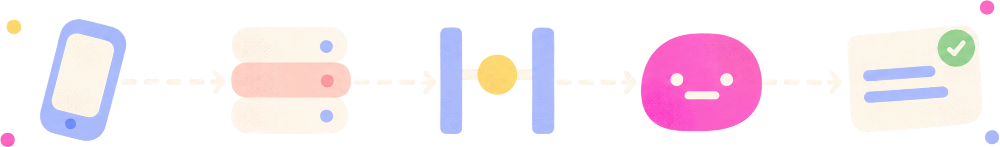

# HALQA — Illustration art direction & generation prompts

Everything here is derived from the deck as it actually renders, not from a mood board.
Five empty slots need art. This document locks one style and gives one prompt per slot.

---

## 1. What the deck already is (measured, not assumed)

| Token | Value | Where it shows up |
|---|---|---|
| `--navy` | `#0E1938` | ground under every slide |
| `--field` | `#0E1938 → #1A1B45 → #2B2257` | body slides |
| `--field-vivid` | `#0E1938 → #6B41BF → #F359D2 → #FFC2C3` | cover + the four dividers |
| `--brand` | `#F45ED1` | the single accent |
| `--brand-lt` | `#FFA4C6` | accent, lighter |
| `--cream` | `#FFFCF6` | type |
| `--peach` | `#FFC2C3` | warm end of the ramp |
| pastels | `#B9C5FA` `#A2DF92` `#FFDA7C` `#FAC2F5` | card tints |
| Big titles | **TT Neoris Bold** (`TTNeoris-Bold.woff2`) | `h1`, `h2`, `01`–`04` section numerals, cover wordmark |
| Small titles | SF Pro | `h3` card headings, stats, labels |
| Body face | SF Pro | all detail |
| Fallback display | League Spartan 700/800 | behind TT Neoris |
| Icons | 33 symbols, 24×24 grid, **1.6 stroke**, round caps, `currentColor` | throughout |

**Slot geometry (measured from the render)**

| Slot | Slide | Box | Ratio |
|---|---|---|---|
| Divider wells | 2, 5, 9, 14 | 330 × 400 | 0.8250 |
| Architecture band | 10 | 1136 × 160 | **7.10 : 1** |

**The constraint that decides everything.** I sampled the well's true surface from the
render — `#26254F`, the composite of its two radial washes over the navy field — then ran
the contrast maths for every brand colour against it:

| Colour | on well | verdict |
|---|---|---|
| `#FFFCF6` cream | 14.1 | |
| `#FFDA7C` yellow | 10.7 | |
| `#FAC2F5` pink | 9.8 | |
| `#FFC2C3` peach | 9.5 | |
| `#A2DF92` green | 9.3 | |
| `#B9C5FA` blue | 8.6 | |
| `#FFA4C6` brand-lt | 7.8 | |
| `#F45ED1` brand | **5.1** | usable, and the floor |
| **`#8E47C4` violet** | **2.6** | **fails — disappears** |
| **`#53379D` deep** | **1.6** | **fails — invisible** |

So the saturated violets that carry the *background* ramp cannot be used as *figure*
fills. Any character or object drawn in `#8E47C4` becomes mud on this ground. The art has
to live on the pale end: cream, peach, the pastels, brand-pink.

Brand-pink at 5.1 is the floor and it is fine — but only because it passes the 3:1
large-graphic bar with margin. It is the darkest ink allowed, which is exactly why it is
rationed to one accent per image rather than used as a fill.

(`#26254F` is not a CSS variable — it is what the well's two stacked radial washes actually
composite to over the navy field, sampled from the render. That is the real surface the art
sits on, which is why it is the number worth testing against, and why the brighter CSS
variables are not.)

This one finding rules out most "brand-coloured flat illustration" output and is the
reason the palette below is not a copy of the CSS variables.

---

## 2. The style decision

**Chosen: cut-paper riso — flat limited-ink vector with paper grain, soft imperfect
blobs, and fine dark detail strokes.**

Why this and not the obvious answer:

- **Not Corporate Memphis.** It is the default output for "flat illustration", and its
  reputation is the problem: audiences have been trained to skip it, and the critique that
  lands hardest — *"it represents everyone and speaks to no one"* — is fatal for a pitch
  whose whole argument is that a specific room, in Tunis, is being failed in four specific
  ways. Generic limb-people would undercut the message on the slide where the message is
  the product.
- **It continues the language the deck already speaks.** The cover is not character
  illustration — it is thin-stroke outlined cards, flat pastel disks and a gradient sweep,
  with no figures anywhere. That is already a line-plus-flat-ink dialect, the same one as
  the 1.6-weight icon sprite. Riso detail is carried by exactly that: a thin dark line over
  flat ink fields. So the art joins the existing system instead of becoming a third voice
  alongside the type, the icons and the cover.
- **2026 has moved to texture and evidence of making.** The strongest current direction
  is tactile: visible grain, layered brushwork, imperfect edges — a deliberate counter to
  smooth AI-generic output. For a competition deck in front of a jury, hand-made reads as
  *cared about* rather than *generated*. The same sources flag quiet graphic minimalism —
  restrained colour, generous space, crisp scaling — which is exactly what a 330px slot on
  a dark field needs. This style sits between those two: minimal shapes, maximal texture.
- **It solves the dark-field problem structurally.** Flat vector on deep ground glows like
  a sticker. Riso logic — translucent ink over paper, overlaps making the third colour,
  paper cream standing in for highlights — manufactures value separation without
  gradients, which the palette above forbids anyway.
- **It degrades gracefully.** At 330px wide in a PDF, fine gradients die. Grain, flat
  fields and one clear silhouette survive. That is the whole test.

### The five rules (the style guide, short enough to enforce)

1. **Line** — no outline on the main shapes, and one fine stroke (~2px at final size)
   for interior detail: fingers, fabric fold, a face. That stroke must be *lighter* than
   the shape it sits on, or a slightly darker tint of the same hue. A dark ink stroke is
   the trap: on the deck's dark field it measures about 1.1:1 and disappears completely.
   Never outline the silhouette.
2. **Shape** — rounded blobs and soft rectangles, drawn from circles, capsules and
   quarter-rounds. Slight, deliberate irregularity. Corner radius 8–18% of the shape's
   short side. Nothing perfectly geometric, nothing noodly.
3. **Colour** — five inks, all opaque, on nothing at all:
   `#FFC2C3` peach · `#FFDA7C` yellow · `#B9C5FA` blue · `#F45ED1` pink · `#A2DF92` green.
   Cream `#FFFCF6` is only ever an object's colour, never a field. Overlaps resolve to one
   fixed lighter tint rather than real translucency (see the style block) — there is no
   paper underneath for a multiply to act on. Green is rationed to one "correct / passes"
   signal per image, which is why it never appears as a "fail" colour. No violet, no deep
   purple, no gradients.
4. **Figures** — real proportions with one exaggeration, not the reverse. Small heads are
   a cliché; keep heads normal and exaggerate *one* thing that carries the meaning (a
   hand, a card, a silence). Skin is deliberately chosen from the pale inks: peach, warm
   cream, `#B9C5FA`, `#FFDA7C`. Vary build, posture and hair. Faces get two dots and a
   line, no more.
5. **Detail** — silhouette only at small size, one accent per figure, grain inside the
   fills. Confetti (squiggle, dot, short arc, cloud blob) at 3–6px, ≤8 elements, never
   touching the subject and never filling the empty space.

**Never** put text, letters, numbers or UI copy in the art. It cannot be translated, it
cannot be read at this size, and the deck has live type for all of it.

---

## 3. The locked style block

Prepend this — unchanged — to every prompt below. Keeping it byte-identical across all
five is what makes the set look like one system instead of five generations.

In the five prompts that follow, the literal line `[STYLE BLOCK]` is a placeholder. Paste
this block in its place so the final prompt is one continuous paragraph: style first, then
the slot's `Subject:`. Style leads because models weight the opening of a prompt more
heavily, and here the style is the invariant while the subject is the variable.

```
NO background, fully transparent canvas, no paper - flat cut-paper illustration, riso-print logic. The artwork is
the subjects only, cut out cleanly, floating on a fully transparent canvas - there is no
paper, no backdrop, no rectangle, no frame, no border, no vignette, no ground plane and no
horizon; every pixel that is not part of a figure or object is transparent. Because there
is no paper, there is no simulated print-through: do not render ink as translucent, do not
blend inks into the empty area, and never use the cream paper colour as a background
field. All shapes
are fully OPAQUE flat colour. Depth comes only from overlapping opaque shapes plus one
fixed lighter overlap tint - #E9DDF5 over blue, #FFE9B8 over yellow, #F6DCEC over pink,
#D7ECD2 over green - never from gradients, shading, blur, glow or drop shadows.

Palette: five inks maximum - peach #FFC2C3, butter yellow #FFDA7C, periwinkle blue
#B9C5FA, hot pink #F45ED1, and grass green #A2DF92 which is rationed to a single
"correct" signal. Cream #FFFCF6 may be used ONLY as the colour of specific objects
(a card, a notebook, a speech shape, a slab) and never as a background field. Soft rounded
organic shapes with slightly imperfect, hand-drawn edges; corner radius 8-14% of the short
side. Line work is minimal: a single fine stroke of about 2px at final size, in a darker
tint of the same hue or in the lightest cream, only for interior detail such as finger
creases, fabric folds and facial features - never a dark outline, and never around the
silhouette.

Figures have natural proportions with exactly one deliberate exaggeration, varied body
types, and deliberately non-naturalistic skin drawn from the pale inks (peach, cream,
periwinkle, yellow). Faces are two dots and one line. Subtle paper grain and a faint
halftone texture INSIDE the flat fills only, giving them a printed feel while the
background stays perfectly transparent. Scattered confetti fillers: a squiggle, a dot, a
short arc, a small cloud blob, 3-6px, at most eight of them, never touching the subject.
Absolutely no lettering, numbers, glyphs, logos or UI text anywhere in the image.
```

Two things that block bad output before it happens:

- *"exactly one deliberate exaggeration"* — the phrase kills the noodle-limb reflex.
- *"Absolutely no lettering"* — image models love to invent captions inside pictures.

---

## 4. The five prompts

### Slot 1 — Slide 2, divider 01 · The problem — 330 × 400

**Argument it has to make:** one voice is mistaken for the whole room's understanding.

```
[STYLE BLOCK]

Subject: six adult learners seated in a loose circle around a low round table, seen from
a slightly raised three-quarter view. Five of them are
small, quiet and seated: shoulders slightly rounded, hands folded or resting flat, mouths
closed, gazes turned down or away. The sixth is the exaggeration: seated in the same
chair but drawn at nearly twice the relative size, leaning forward, chest open, one
oversized hand raised mid-gesture, a large empty peach speech shape radiating from them
in three concentric arcs that push the other five figures outward. The size difference is
the only distortion. The table holds a single open notebook and two cups, no screens.
Composition: the group fills the lower two thirds, the speaking arcs occupy the upper
third, the top right is left as empty transparent space. The
quiet five are one continuous cluster of overlapping blue, peach and yellow shapes; the
speaker is the only figure in hot pink. Mood: a familiar room, quietly uncomfortable, not
a disaster.
```

**Negative:** `background, backplate, backdrop, paper texture in the background, cream paper field, coloured rectangle behind the subject, frame, border, vignette, ground plane, horizon line, floor, drop shadow, cast shadow, glow, bloom, gradient, semi-transparent ink, see-through shapes, white background, off-white background, checkerboard, transparent checkerboard pattern, lettering, text, speech bubble words, laptops, phones, 3D, violet or dark purple figures, noodle limbs, tiny heads, corporate memphis, stock vector look, watermark`

**Size:** 1248 × 1512 (0.8254). Both sides divisible by 16, which the generator
validates. This crops 0.05% off the sides — under a pixel at display size.
**Background:** transparent PNG, and add class `art` to the well so the wash underneath
drops out.

---

### Slot 2 — Slide 5, divider 02 · The solution — 330 × 400

**Argument:** the circle answers first; the AI is held behind a gate until it can only add.

```
[STYLE BLOCK]

Subject: the same study circle, now in a calmer arrangement. Three learners around a low
table; one has just spoken and their cream speech shape is filled
with three overlapping ink shapes, another is nodding, a third is mid-write in a small
notebook. A second, smaller speech shape sits directly beside it, clearly incomplete: held
behind a simple rounded gate — two vertical bars of periwinkle blue with a horizontal
crossbar — that keeps it apart from the group. Behind the gate, drawn at about a third
the size of the people, a small abstract assistant: a soft rounded node with two dots and
a horizontal line, a tiny clock arc above it, waiting, no face and no body. It is
physically outside the circle. The gate is the focal point of the composition and sits
dead centre. Composition: circular grouping in the lower half, gate and waiting assistant
in the upper middle, surrounded by empty transparent space. The AI element uses periwinkle blue and
one hot pink accent only — it must read as quieter than the people. Mood: patient,
deliberate, warm; the machine is present and subordinate.
```

**Negative:** `background, backplate, backdrop, paper texture in the background, cream paper field, coloured rectangle behind the subject, frame, border, vignette, ground plane, horizon line, floor, drop shadow, cast shadow, glow, bloom, gradient, semi-transparent ink, see-through shapes, white background, off-white background, checkerboard, transparent checkerboard pattern, lettering, text, 3D, violet or dark purple figures, corporate memphis, stock vector look, watermark, speech bubble words, robot, humanoid AI, glowing AI, futuristic HUD, circuit board, chat window, laptops, phones`

**Size:** 1248 × 1512. **Background:** transparent PNG, `.art` on the well.

---

### Slot 3 — Slide 9, divider 03 · The technology — 330 × 400

**Argument:** one hard line between ordinary code and AI calls — the pitch's structural claim.

```
[STYLE BLOCK]

Subject: a single continuous vertical line, two pixels of cream ink, running the full
height of the frame and dividing it into two unequal halves — left of the line takes about
55% of the width. Left side: ordinary code, rendered as flat stacked slabs and capsules in
periwinkle and peach, a few rounded rectangles of different heights like shelved blocks,
two of them overlapping to make a darker third tone, one small green square as the only
green in the image. Right side: the AI side, rendered as three soft rounded blobs
connected by one dotted cream arc, loosely clustered, breathing more than the rigid left
side, in butter yellow and hot pink. Where the two sides meet, the vertical line passes
through a single narrow horizontal gate: a small cream capsule with a crossbar, held by
one hand entering from the left edge. No screens, no terminals, no text. Composition:
vertical symmetry broken by the unequal split, subjects stacked full height, the gate at
the vertical centre at 45% from the top. Mood: ordered, legible, slightly tense at the
seam.
```

**Negative:** `background, backplate, backdrop, paper texture in the background, cream paper field, coloured rectangle behind the subject, frame, border, vignette, ground plane, horizon line, floor, drop shadow, cast shadow, glow, bloom, gradient, semi-transparent ink, see-through shapes, white background, off-white background, checkerboard, transparent checkerboard pattern, lettering, text, 3D, violet or dark purple figures, corporate memphis, stock vector look, watermark, text on screens, circuit board, motherboard, neon, matrix code, hologram, wires, cables, terminals, laptops`

**Size:** 1248 × 1512. **Background:** transparent PNG, `.art` on the well.

---

### Slot 4 — Slide 10, architecture band — 1136 × 160

**Argument:** request → code → AI → answer. Cheap by design, quota booked first.

This slot is 7.1:1 and no model generates that. **Generate at 21:9 and compose for a
centre-safe strip** — `object-fit:cover` keeps only the middle ~33% of the height, so the
prompt must demand that the top and bottom thirds are empty.

```
[STYLE BLOCK]

Subject: a horizontal left-to-right flow of five flat objects, evenly spaced across a wide
panorama. Read in order: (1) a small rounded phone shape in
periwinkle, tilted slightly; (2) a server, three stacked cream slabs with one peach
slab; (3) a narrow gate, two vertical bars with a crossbar and a tiny butter-yellow
quota token resting against it; (4) a soft rounded node in hot pink, the AI, with two dots
and a line and nothing else; (5) an answer, a cream card with two fine light-blue line marks
inside it and one small green check-corner. Connect the five with one continuous
2px cream line of arrowed dashes, running dead level through the vertical centre of the
frame. Everything important sits inside a narrow horizontal strip through the middle of
the image, roughly the middle third of the height. The top third and the bottom third are
completely empty and transparent, holding only four or five tiny confetti dots near the
edges, nothing else. No perspective, no floor, no shadow, no ground line. Mood: mechanical
clarity, calm, cheap and repeatable.
```

**Negative:** `background, backplate, backdrop, paper texture in the background, cream paper field, coloured rectangle behind the subject, frame, border, vignette, ground plane, horizon line, floor, drop shadow, cast shadow, glow, bloom, gradient, semi-transparent ink, see-through shapes, white background, off-white background, checkerboard, transparent checkerboard pattern, lettering, text, 3D, violet or dark purple figures, corporate memphis, stock vector look, watermark, perspective, isometric, horizon, gradient sky, top-heavy composition with the subject near the top edge, bottom-heavy composition with the subject near the bottom edge`

**Size:** **1536 × 432** (3.56:1) if your tool takes custom sizes — the well then keeps
50% of the height. Otherwise **2016 × 864** (21:9, the widest standard ratio), where it
keeps only 33%. Either way the well shows just the middle 160px, which is why the prompt
spends a third of its words insisting the top and bottom thirds stay empty.
**Background:** transparent PNG, `.art` on the well (`class="well band art"`) so the 14px
border and wash drop out and the strip floats.

---

### Slot 5 — Slide 14, divider 04 · The business — 330 × 400

**Argument:** the learner never pays; the school pays for proof that students are learning.

```
[STYLE BLOCK]

Subject: a handover. Two figures facing each other in profile at mid distance, both full
length, of clearly different build — the left figure is tall and broad
in periwinkle, standing, in a plain shirt with the sleeves rolled, the right figure is
smaller and seated in butter yellow, leaning slightly forward, hands out to receive. The
exaggeration is the object between them: a single cream card, drawn at about the size of a
face, held at the exact centre of the frame by both pairs of hands at once. Inside the
card, two fine light-blue line marks and nothing else. Behind them, low and cut off by the bottom
edge, a row of four rounded chair backs in peach, receding and slightly overlapping, to
place this inside a room. To the upper right, three overlapping rounded bars rising
left-to-right in peach, hot pink and periwinkle — growth, stated once, small. Composition:
the card is the vanishing point; figures occupy the lower two thirds, the rising bars sit
small in the upper right, empty transparent space between them. Mood: a quiet transaction,
warm, unceremonious, not a sale.
```

**Negative:** `background, backplate, backdrop, paper texture in the background, cream paper field, coloured rectangle behind the subject, frame, border, vignette, ground plane, horizon line, floor, drop shadow, cast shadow, glow, bloom, gradient, semi-transparent ink, see-through shapes, white background, off-white background, checkerboard, transparent checkerboard pattern, lettering, text, 3D, violet or dark purple figures, corporate memphis, stock vector look, watermark, handshake, suit, briefcase, money, currency, coins, piggy bank, chart with axes, dashboard, laptops`

**Size:** 1248 × 1512. **Background:** transparent PNG, `.art` on the well.

---

## 5. Production notes

**Sequence.** Generate slot 1 first. Iterate only on it until the paper grain, the face
treatment and the one-exaggeration rule look right. Then reuse slot 1's output as a style
reference for 2, 3 and 5 rather than re-rolling from the text alone. That is the single
highest-leverage thing in this document: the style block does most of the work, the
reference image does the rest.

**Aspect ratios.** Measured from the PDF's own vector geometry, the four divider wells are
**330 × 400 — ratio 0.8250**. Not 5:6 (0.8333), so a 5:6 generation would trim 1% off the
sides. Generate **1248 × 1512** (0.8254; both sides divisible by 16, which the generator
validates and 1250 × 1500 does not). That crops 0.05% off the sides — invisible.

For the band, the slot is **1136 × 160 = 7.10:1**, which no model produces. Generate 21:9
at **2016 × 864** and accept that the well shows the middle **33%** of the height; the
prompt is written for exactly that crop. If your tool takes custom sizes, **1536 × 432**
(3.56:1) is the better target — it keeps **50%** of the height instead of a third, which
halves the risk that the flow line lands outside the visible strip.

**Background — the part that matters most.** Every prompt above demands a fully
transparent canvas in its opening sentence and again in its negative list, because
"no background" is the single instruction models drop hardest. Three things to know:

- **Transparent PNG is the goal.** The `.well.art` rule drops the wash and border, so
  transparent art sits straight on the deck's field with no rectangle around it. That
  rectangle is exactly what makes illustration on dark themes look pasted in.
- **Some tools cannot output alpha.** If yours is one of them, do *not* fall back to
  cream paper — a cream plate behind the art is the failure this whole instruction exists
  to prevent. Fall back to the deck's own field colour, `#0E1938`, flat, with no shadow,
  and leave the well **un-arted** (keep the existing wash) so the mismatch hides inside
  the well's border instead of floating loose on the slide.
- **Grain is the compromise.** Grain inside the fills still reads as printed; grain over
  the empty area would look like a dirty rectangle. The prompts already scope it to
  "inside the flat fills only".

**Placement.** Drop each file into its well and add the `art` class. Dividers:

```html
<div class="well art"></div>
```

Band (keeps the `band` class, adds `art`):

```html
<div class="well band art"></div>
```

The existing `.well>img` rule already stretches the image to cover. `alt=""` is correct
here: these are decorative, and every one restates a heading that is already live text, so
a description would only repeat what a screen reader has just announced.

**Files and names.** `img/art-01-problem.png`, `art-02-solution.png`,
`art-03-technology.png`, `art-04-band.png`, `art-05-business.png` — all inside the existing
`img/` folder, which currently holds only `cover-art.jpg`.

**Export check after placing.** Re-run the PDF export and the contrast auditor. The art
introduces no text, so contrast should not move. Two layout things to eyeball:

- The divider wells sit in a two-column grid beside the `01`–`04` ghost numerals at 132px.
  A busy illustration will compete with them. If the numeral loses, crop the art tighter
  rather than dimming the numeral — the numeral is the wayfinding.
- The band is `1136 × 160` with `object-fit:cover` by default. If your art has a hard
  edge you want respected, override it inline on that one image —
  ``. The prompt's
  centre-safe strip is the alternative that lets you keep the CSS default of `cover`.

**One risk worth naming.** Grain and translucency are the things that make this style read
as printed rather than generated — and they are also the things compression eats. At
330px wide in a PDF, keep grain subtle; a heavy overlay will read as noise on a projector,
and this deck will be shown on a projector in front of a jury.
